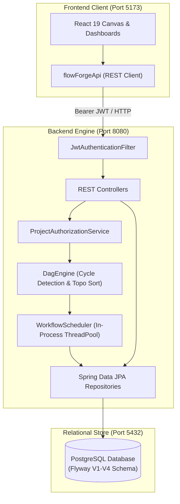

# FlowForge

[](https://github.com/AditiMurkute8/FlowForge/actions/workflows/backend-ci.yml)

FlowForge is a developer-focused visual workflow orchestration platform designed for modeling, validating, and executing complex multi-step task dependency pipelines. It combines a high-performance Directed Acyclic Graph (DAG) validation engine, transactional relational persistence, role-based project authorization, and an interactive browser-based visual canvas.

---

## Current Project Status

FlowForge is currently at the conclusion of **Phase 1: Single-Node Core Engine**.

| Completed in Phase 1 | Planned for Future Phases (Not Yet Implemented) |
| :--- | :--- |
| Pure algorithmic DAG modeling with cycle detection and Kahn's topological sorting | Distributed worker pools executing tasks outside the API process |
| Single-process multi-threaded task scheduler with bounded concurrency and timeouts | Lease-based task dispatch and heartbeat-driven worker crash recovery (Phase 2) |
| Transactional PostgreSQL persistence with Flyway-managed schema migrations | Full Docker Compose orchestration for multi-container deployments (Phase 3) |
| Enforced database-level immutability for workflow version definitions | Kafka event-driven message streaming and durable result reconciliation (Phase 4) |
| Durable workflow run execution history and task lifecycle state tracking | Distributed tracing with OpenTelemetry, Prometheus, and Grafana (Phase 5) |
| Stateless JWT authentication (BCrypt hashing) and project-level RBAC | Decoupled AI workflow generation and log failure analysis (Phase 6) |
| Interactive React 19 visual workflow builder with dual Light/Dark themes | Multi-scheduler leader election and cloud-native clustering (Phase 7) |

> [!NOTE]
> FlowForge is currently an active engineering prototype and is **not yet production-ready**. All task execution currently runs within the single-node Spring Boot server process.

---

## Features

### 1. Workflow DAG Modeling & Dependency Validation
- **Directed Dependency Semantics:** Explicit `prerequisite -> dependent` edge semantics (`source -> target`). A dependent task is guaranteed not to run until all upstream prerequisites complete successfully.
- **Deep Cycle Detection:** Iterative 3-color Depth-First Search (`WHITE`, `GRAY`, `BLACK`) in [`DagEngine`](backend/src/main/java/com/flowforge/core/DagEngine.java) that detects self-loops and complex cycles with full stack safety, reporting precise cycle paths.
- **Deterministic Topological Sort:** Implementation of Kahn's algorithm with lexicographical priority queue tie-breaking, ensuring deterministic task scheduling order across executions.
- **Structural Integrity Checks:** Rejects duplicate task identifiers, duplicate edges, and references to undeclared tasks; automatically flags disconnected/isolated task nodes.

### 2. Single-Node In-Process Task Scheduler
- **Parallel Branch Execution:** Dynamically evaluates task readiness as upstream tasks finish, executing independent branches concurrently across a managed Java thread pool.
- **Bounded Capacity:** Hard admission control via server-level `Semaphore` permits (`flowforge.scheduler.max-concurrent-workflows`), quarantining permits if scheduler shutdown cannot be positively verified.
- **Timeout Enforcement:** Synchronous execution timeout (`CompletableFuture.orTimeout`) yielding clean HTTP `504 Gateway Timeout` responses when workflows exceed configured deadlines (`flowforge.scheduler.execution-timeout-seconds`).
- **Resilient Retry Policies:** Configurable max attempts, fixed backoff, and exponential backoff with full jitter to prevent thundering herd effects.
- **Task Lifecycle Tracking:** Strict task state transitions: `PENDING` &rarr; `RUNNING` &rarr; `COMPLETED`, `FAILED`, or `CANCELLED`.

### 3. Transactional Persistence & Audit Trail
- **PostgreSQL Source of Truth:** Foreign-key referential integrity with strict delete constraints (`ON DELETE RESTRICT` for workflows and runs).
- **Immutable Workflow Versions:** Database triggers (`enforce_workflow_version_immutability` and `enforce_workflow_version_no_delete`) block in-place `UPDATE` and `DELETE` operations on historical workflow version snapshots.
- **Durable Run History:** Persisted workflow runs and granular task runs storing attempt counts, start/end timestamps, duration in milliseconds, and sanitized error outputs.
- **Flyway Migrations:** Repeatable, version-controlled schema evolution under [`backend/src/main/resources/db/migration/`](backend/src/main/resources/db/migration/).

### 4. Authentication & Role-Based Access Control (RBAC)
- **Stateless JWT Security:** Authentication via standard `Authorization: Bearer <token>` headers signed with HMAC-SHA256.
- **Password Protection:** BCrypt password hashing for user credential storage.
- **Project-Level Authorization:** Fine-grained roles assigned per project:
  - **`ADMIN`:** Full control (manage members, delete projects/workflows, create workflows, trigger runs). Pessimistic locking prevents demoting or removing the last project administrator.
  - **`DEVELOPER`:** Operational control (create and edit workflows, create versions, trigger runs).
  - **`VIEWER`:** Read-only access (inspect project workflows, versions, and execution histories).

### 5. Modern Frontend Experience
- **Interactive Visual Canvas:** Built with React 19 and `@xyflow/react`, featuring draggable task palettes, connection snapping, dynamic port layout, and fit-view controls.
- **Dual-Theme Design System:** Cohesive Light and Dark modes built with Tailwind CSS v4 variables and system media query fallbacks.
- **Workflow & Run Inspection:** Modal telemetry for live and historical workflow runs, step-by-step task status badges, execution logs, and project member management.

---

## Technology Stack

### Frontend
- **Framework:** [React 19](https://react.dev/) (`^19.0.0`) with [TypeScript](https://www.typescriptlang.org/) (`~5.7.3`)
- **Build Tool:** [Vite](https://vite.dev/) (`^6.2.0`)
- **Canvas / Flow Graph:** [@xyflow/react](https://reactflow.dev/) (`^12.4.4`)
- **Styling:** [Tailwind CSS v4](https://tailwindcss.com/) (`^4.0.9`)
- **Icons:** [Lucide React](https://lucide.dev/) (`^0.475.0`)
- **Testing:** [Vitest](https://vitest.dev/) (`^3.0.7`)
- **Linter:** [Oxlint](https://oxc.rs/) (`^0.15.12`)

### Backend
- **Language / Runtime:** Java 17 or 22
- **Framework:** [Spring Boot 3.4.3](https://spring.io/projects/spring-boot)
  - `spring-boot-starter-web` (REST APIs)
  - `spring-boot-starter-security` (Stateless JWT Security)
  - `spring-boot-starter-data-jpa` (Hibernate 6 persistence)
  - `spring-boot-starter-validation` (Bean validation constraints)
  - `spring-boot-starter-actuator` (Health and telemetry endpoints)
- **Security & Tokens:** JJWT (`io.jsonwebtoken:jjwt-api:0.12.6`)
- **Build Tool:** Apache Maven 3.9.9 via Maven Wrapper (`mvnw` / `mvnw.cmd`)

### Database & Migrations
- **Database Engine:** PostgreSQL 16+ (tested against PostgreSQL 16 and 18)
- **Connection Pool:** HikariCP
- **Database Migrations:** Flyway (`flyway-core` & `flyway-database-postgresql`)

### Testing & Infrastructure
- **Unit & Slice Testing:** JUnit 5, Mockito, AssertJ, Spring Security Test
- **PostgreSQL Integration Tests:** [Testcontainers](https://testcontainers.com/) (`1.20.4`) running authoritative PostgreSQL containers during automated tests
- **Continuous Integration:** GitHub Actions runner (`ubuntu-latest`)

---

## Architecture Overview

FlowForge Phase 1 operates as a unified single-process architecture. The React frontend interacts with the Spring Boot backend over HTTP/REST. Within the backend, requests are authenticated, authorized against project memberships, validated for topological correctness, and executed across an in-memory thread pool before persisting results directly to PostgreSQL.



### Architectural Decisions
- For the architectural rationale on choosing DAG models and PostgreSQL as the authoritative state store, see [ADR-001: Adoption of DAGs and PostgreSQL](docs/adr/ADR-001-why-dags-and-postgresql.md).
- Detailed delivery milestones and checklist are maintained in [Project Roadmap & Verification Checklist](docs/PROJECT_CHECKLIST.md).

---

## Repository Structure

```
FlowForge/
├── .github/
│   └── workflows/
│       └── backend-ci.yml           # CI definition for backend tests & frontend checks
├── backend/
│   ├── src/
│   │   ├── main/
│   │   │   ├── java/com/flowforge/
│   │   │   │   ├── api/             # REST controllers, DTOs, and global exception handlers
│   │   │   │   ├── config/          # Security, CORS, and scheduler property configurations
│   │   │   │   ├── core/            # Framework-free DAG graph model, validation, and topological sorting
│   │   │   │   ├── domain/          # JPA entities (Project, Workflow, Version, Run, TaskRun, User)
│   │   │   │   ├── persistence/     # Spring Data JPA repositories
│   │   │   │   ├── scheduler/       # In-process task scheduler, retry policies, and state transitions
│   │   │   │   ├── service/         # Business services (Auth, Project, Workflow, Run, Membership)
│   │   │   │   └── FlowForgeApplication.java
│   │   │   └── resources/
│   │   │       ├── application.yml  # Application properties and environment variable bindings
│   │   │       └── db/migration/    # Flyway SQL migrations (V1 to V4)
│   │   └── test/                    # Unit, slice, and PostgreSQL Testcontainers integration tests
│   ├── mvnw                         # Maven wrapper (Unix)
│   ├── mvnw.cmd                     # Maven wrapper (Windows)
│   └── pom.xml                      # Maven project descriptor
├── docs/
│   ├── adr/
│   │   └── ADR-001-why-dags-and-postgresql.md # Architecture Decision Record
│   └── PROJECT_CHECKLIST.md         # Full project lifecycle roadmap (Phases 0–7)
├── src/                             # React 19 TypeScript application
│   ├── api/                         # Frontend API client and TypeScript endpoint definitions
│   ├── components/                  # UI components, canvas nodes, modals, and palettes
│   ├── context/                     # Auth context and route security guards
│   ├── pages/                       # Projects Dashboard and Workflow Builder pages
│   ├── utils/                       # Graph validation, adapters, and RBAC utility helpers
│   ├── App.tsx                      # Root application component with layout shell
│   ├── index.css                    # Design system tokens and Tailwind CSS rules
│   └── main.tsx                     # Vite entry point
├── package.json                     # Frontend scripts and dependencies
├── tsconfig.json                    # TypeScript compiler configuration
├── vite.config.ts                   # Vite bundler configuration
└── README.md                        # Project documentation
```

---

## Prerequisites

Before running FlowForge locally, ensure you have the following installed:

1. **Java Development Kit (JDK):** Version 17 or 22.
2. **Node.js & npm:** Node.js v20+ (tested on Node.js v22) with npm v10+.
3. **PostgreSQL Database:** PostgreSQL 16+ running locally or in Docker.
4. **Docker:** Required if running PostgreSQL via a container, and **required** if running the backend PostgreSQL integration test suite via Testcontainers.

---

## Getting Started

### 1. Database Setup
Start a local PostgreSQL instance or launch one using Docker:

```bash
docker run -d \
  --name flowforge-postgres \
  -e POSTGRES_DB=flowforge \
  -e POSTGRES_USER=postgres \
  -e POSTGRES_PASSWORD=postgres \
  -p 5432:5432 \
  postgres:16-alpine
```

### 2. Backend Configuration and Startup
The backend requires a 256-bit (minimum 32-character) secret key for JWT signing. Configure this via the `FLOWFORGE_JWT_SECRET` environment variable.

#### On Linux / macOS:
```bash
cd backend
export FLOWFORGE_JWT_SECRET="replace-with-a-secure-secret-key-at-least-32-chars-long"
export SPRING_DATASOURCE_URL="jdbc:postgresql://localhost:5432/flowforge"
export SPRING_DATASOURCE_USERNAME="postgres"
export SPRING_DATASOURCE_PASSWORD="postgres"

./mvnw spring-boot:run
```

#### On Windows (PowerShell):
```powershell
cd backend
$env:FLOWFORGE_JWT_SECRET = "replace-with-a-secure-secret-key-at-least-32-chars-long"
$env:SPRING_DATASOURCE_URL = "jdbc:postgresql://localhost:5432/flowforge"
$env:SPRING_DATASOURCE_USERNAME = "postgres"
$env:SPRING_DATASOURCE_PASSWORD = "postgres"

.\mvnw.cmd spring-boot:run
```

Upon startup, Flyway will automatically execute migrations `V1` through `V4`, initializing all tables and constraints. The backend API will be available at `http://localhost:8080`.

### 3. Frontend Installation and Startup
From the repository root:

```bash
# Install frontend dependencies
npm install

# Start the Vite development server
npm run dev
```

The frontend will start at `http://localhost:5173/`. Open this URL in your browser to access the FlowForge workspace.

---

## Configuration

All configuration values can be adjusted via environment variables or Spring application properties.

| Variable | Default Value | Description |
| :--- | :--- | :--- |
| `FLOWFORGE_JWT_SECRET` | *(None / Required)* | HMAC-SHA256 signing key for JWT tokens. **Must be at least 32 characters (256 bits)**. |
| `FLOWFORGE_JWT_EXPIRATION_MS` | `86400000` | JWT token validity window in milliseconds (default: 24 hours). |
| `SPRING_DATASOURCE_URL` | `jdbc:postgresql://localhost:5432/flowforge` | JDBC connection URL for PostgreSQL. |
| `SPRING_DATASOURCE_USERNAME` | `postgres` | Database username. |
| `SPRING_DATASOURCE_PASSWORD` | `postgres` | Database password. |
| `SPRING_FLYWAY_ENABLED` | `true` | Enables or disables automated Flyway database schema migrations. |
| `VITE_API_BASE_URL` | `http://localhost:8080` | Frontend target URL for backend REST API calls. |
| `flowforge.scheduler.max-concurrent-workflows` | `4` | Maximum concurrent workflows admitted by the server semaphore. |
| `flowforge.scheduler.execution-timeout-seconds` | `15` | Maximum synchronous execution timeout before returning HTTP `504`. |

> [!CAUTION]
> Never commit actual passwords, tokens, or private secrets to version control. Keep `.env` files untracked.

---

## API Overview

### Public Endpoints

| Method | Endpoint | Description |
| :--- | :--- | :--- |
| `POST` | `/api/v1/auth/register` | Register a new user account with email, password, and full name. |
| `POST` | `/api/v1/auth/login` | Authenticate user credentials and receive a JWT Bearer token. |
| `POST` | `/api/v1/dag/validate` | Lightweight DAG structure validation, cycle detection, and topological sorting (bounded to 50 nodes). |
| `GET` | `/actuator/health` | Spring Boot Actuator application health indicator. |
| `GET` | `/actuator/info` | Application metadata and build details. |

### Protected Endpoints
*Requires header: `Authorization: Bearer <token>`*

| Method | Endpoint | Minimum Role | Description |
| :--- | :--- | :--- | :--- |
| `GET` | `/api/v1/auth/me` | Authenticated | Retrieve profile details of the currently authenticated user. |
| `POST` | `/api/v1/projects` | Authenticated | Create a new project. The creator is automatically assigned the `ADMIN` role. |
| `GET` | `/api/v1/projects` | Authenticated | List all accessible projects with pagination. |
| `GET` | `/api/v1/projects/{projectId}` | `VIEWER` | Retrieve project details by UUID. |
| `GET` | `/api/v1/projects/slug/{slug}` | `VIEWER` | Retrieve project details by URL-friendly slug. |
| `DELETE` | `/api/v1/projects/{projectId}` | `ADMIN` | Delete a project and its memberships. |
| `GET` | `/api/v1/projects/{projectId}/members` | `VIEWER` | List members and their assigned roles for a project. |
| `POST` | `/api/v1/projects/{projectId}/members` | `ADMIN` | Add or update a project member's role (`ADMIN`, `DEVELOPER`, `VIEWER`). |
| `DELETE` | `/api/v1/projects/{projectId}/members/{userId}` | `ADMIN` | Remove a member from a project (guarded against removing the last admin). |
| `POST` | `/api/v1/projects/{projectId}/workflows` | `DEVELOPER` | Create a new workflow definition inside a project. |
| `GET` | `/api/v1/projects/{projectId}/workflows` | `VIEWER` | List workflows belonging to a project with pagination. |
| `GET` | `/api/v1/workflows/{workflowId}` | `VIEWER` | Retrieve workflow details by UUID. |
| `DELETE` | `/api/v1/workflows/{workflowId}` | `ADMIN` | Delete a workflow. |
| `POST` | `/api/v1/workflows/{workflowId}/versions` | `DEVELOPER` | Create an immutable workflow version snapshot containing DAG structure and task configs. |
| `GET` | `/api/v1/workflows/{workflowId}/versions` | `VIEWER` | List all historical versions for a workflow. |
| `GET` | `/api/v1/workflows/{workflowId}/versions/latest` | `VIEWER` | Retrieve the latest version snapshot for a workflow. |
| `GET` | `/api/v1/workflows/{workflowId}/versions/{versionNumber}` | `VIEWER` | Retrieve a specific historical version snapshot. |
| `POST` | `/api/v1/workflows/{workflowId}/runs` | `DEVELOPER` | Execute a workflow version synchronously with durable run and task persistence. |
| `GET` | `/api/v1/workflows/{workflowId}/runs` | `VIEWER` | List durable workflow execution history with pagination. |
| `GET` | `/api/v1/runs/{runId}` | `VIEWER` | Retrieve detailed status of a specific workflow run, including executed task runs. |
| `GET` | `/api/v1/runs/{runId}/tasks` | `VIEWER` | List individual task execution records for a run. |
| `POST` | `/api/v1/workflows/execute` | Authenticated | **Transient Execution:** Submit and execute a workflow graph synchronously without persisting run history to the database. |

---

## Testing

FlowForge maintains comprehensive test suites across both the frontend and backend.

### Frontend Tests
Execute frontend checks from the root directory:

```bash
# Run Vitest unit and integration test suite
npm test

# Run TypeScript static type checking
npm run typecheck

# Run Oxlint static analysis
npm run lint

# Verify production bundle compilation
npm run build
```

*Recent verification:* 16 test files (389 tests) pass with 0 errors, 0 type issues, and 0 lint warnings.

### Backend Tests
Execute backend tests from the `backend/` directory:

```bash
# Unix
./mvnw test

# Windows (PowerShell)
.\mvnw.cmd test
```

#### PostgreSQL Testcontainers Integration Tests
Integration tests verifying database behavior—including `FlywayMigrationPostgresTest`, `AuthPersistencePostgresTest`, `WorkflowRunExecutionPostgresTest`, `WorkflowRunPersistencePostgresTest`, and `ProjectMemberConcurrencyPostgresTest`—use **Testcontainers** to dynamically spin up a real PostgreSQL container.
- **Requirement:** A running Docker daemon is required to execute these integration tests.
- When running in environments without Docker, unit tests that do not depend on Testcontainers use an embedded H2 database or mock repository layers.

*Recent verification:* 379 tests executed across 39 backend test classes with 0 failures and 0 errors. Note that past results reflect the verified baseline state and do not guarantee future branch changes pass without running the suite.

---

## Continuous Integration (CI)

Continuous Integration is automated via GitHub Actions in [`.github/workflows/backend-ci.yml`](.github/workflows/backend-ci.yml), which triggers on all pushes and pull requests across all branches:

1. **`backend-test` Job:**
   - Environments: Ubuntu latest with Eclipse Temurin JDK 22.
   - Executes authoritative PostgreSQL Testcontainers tests (`FlywayMigrationPostgresTest`, `AuthPersistencePostgresTest`, `WorkflowRunPersistencePostgresTest`, `WorkflowRunExecutionPostgresTest`, `ProjectMemberConcurrencyPostgresTest`).
   - Verifies Surefire XML reports via Python to ensure required PostgreSQL tests were executed with **0 skips, 0 failures, and 0 errors**.
   - Runs the full Maven test suite.
2. **`frontend-check` Job:**
   - Environment: Ubuntu latest with Node.js 20.
   - Executes `npm ci`, `npm test` (Vitest), `npm run typecheck` (`tsc --noEmit`), `npm run lint` (`oxlint`), and `npm run build` (`vite build`).

---

## Roadmap

The overall development roadmap for FlowForge spans eight milestones as documented in [PROJECT_CHECKLIST.md](docs/PROJECT_CHECKLIST.md):

- [x] **Phase 0: Product Design & Visual UI Foundation** — Design system, UI kit, visual DAG canvas, and client-side validation.
- [x] **Phase 1: Single-Node Core Engine** — Backend Spring Boot service, DAG validation engine, PostgreSQL persistence, Flyway migrations, bounded in-process scheduler, JWT authentication, and RBAC.
- [ ] **Phase 2: Real Workers & Failure Recovery** *(Planned)* — Out-of-process task workers, worker registration, heartbeat mechanisms, lease-based task execution, and orphaned task reclamation.
- [ ] **Phase 3: Dockerization & End-to-End Container Orchestration** *(Planned)* — Multi-container Docker Compose setup, failure simulation test suite, and end-to-end containerized CI.
- [ ] **Phase 4: Kafka / Event-Driven Messaging Core** *(Planned)* — Durable event streaming between scheduler and distributed workers, idempotency keys, and dead-letter queues.
- [ ] **Phase 5: Observability & Load Testing** *(Planned)* — OpenTelemetry distributed tracing, Prometheus metrics, Grafana dashboards, and high-concurrency benchmarks.
- [ ] **Phase 6: Bounded AI Assistant** *(Planned)* — Decoupled Python/FastAPI service for human-supervised natural-language DAG generation and automated task failure diagnosis.
- [ ] **Phase 7: High Availability & Cloud Deployment** *(Planned)* — Multi-scheduler leader election (Redis), cloud deployment manifests, and portfolio-grade documentation.

---

## Contributing

1. **Branching Strategy:** Create topic branches off `main` or the designated feature branch using conventional branch names (`feature/<feature-name>`, `fix/<bug-name>`).
2. **Local Verification:** Always run both frontend and backend verification suites before opening a pull request:
   ```bash
   # Frontend
   npm test && npm run typecheck && npm run lint && npm run build

   # Backend
   cd backend && ./mvnw test
   ```
3. **Commit Conventions:** Follow clear, descriptive commit messages adhering to standard conventional commit prefixes (`feat:`, `fix:`, `docs:`, `test:`, `refactor:`).
4. **Pull Requests:** Open a pull request targeting the active development branch with a clear summary of changes, motivation, and verification steps.

---

## Known Limitations

- **Single-Node Execution Model:** All workflow task executions run in-memory within the Spring Boot process. If the backend process crashes or restarts, active workflow executions will be abruptly terminated.
- **No Distributed Worker Fleet:** Worker process isolation, remote heartbeats, and out-of-process task dispatch are not yet built (scheduled for Phase 2).
- **Synchronous Execution Latency:** Workflow runs submitted via REST endpoints execute synchronously on the server and block the HTTP connection until completion or timeout (governed by `flowforge.scheduler.execution-timeout-seconds`, default 15s).
- **Transient vs. Durable Endpoints:** The `/api/v1/workflows/execute` endpoint executes graphs in-memory and does not record history in PostgreSQL. For durable audit history, use the versioned `/api/v1/workflows/{workflowId}/runs` API.
- **Pending End-to-End UI Audit:** While all automated unit, integration, and build checks are passing, a full end-to-end visual and browser-interaction audit remains pending prior to Phase 2 kickoff.

---

## License

No license has been specified for this repository. All rights are reserved by the repository owner.
