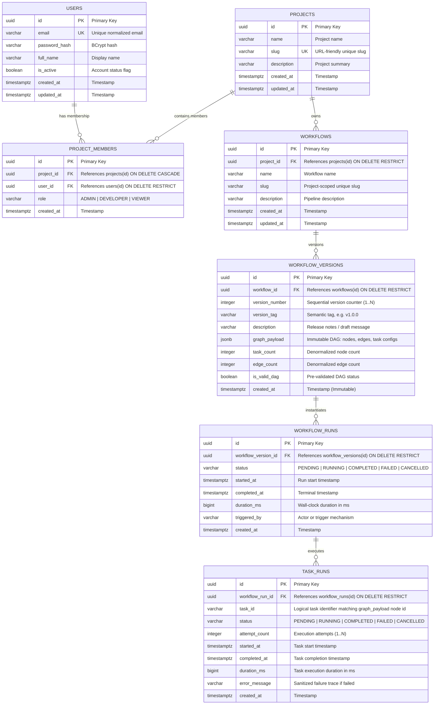

# FlowForge — Database Architecture & Entity-Relationship Model

* **Scope:** Phase 0 & Phase 1 Canonical Relational Persistence Specification
* **Target Engine:** PostgreSQL 16+
* **Migration Mechanism:** Flyway (`V1`–`V4` migrations in `backend/src/main/resources/db/migration/`)
* **Document Status:** Authoritative Baseline

---

## 1. Architectural Model & Persistence Strategy

FlowForge utilizes a hybrid relational-document persistence model in PostgreSQL:

1. **Relational Core for Administrative & Operational Entities:** Projects, memberships, workflows, runs, and individual task run executions are represented as first-class relational tables enforcing ACID transactions, foreign key integrity (`ON DELETE RESTRICT` / `CASCADE`), and check constraints.
2. **Versioned Document Snapshots for Graph Topologies:** Unlike legacy workflow engines that decompose Directed Acyclic Graphs (DAGs) into normalized relational `tasks` and `task_dependencies` rows, FlowForge persists the complete task and dependency topology inside an immutable `JSONB` document (`workflow_versions.graph_payload`).
3. **Immutability Protection:** PostgreSQL triggers (`trg_workflow_version_immutable` and `trg_workflow_version_no_delete`) block all `UPDATE` and `DELETE` operations on `workflow_versions`. This guarantees that historical workflow definitions can never be modified or silently corrupted.
4. **Execution Telemetry:** When a workflow run executes, individual task lifecycles are persisted relationally in `task_runs` (`(workflow_run_id, task_id)` unique), preserving attempt counts, error messages, and execution durations.

---

## 2. Entity-Relationship Diagram

---

## 3. Structural Distinction: Relational Tasks vs. JSONB Graph Payload

| Property | Normalized Relational Schema (`tasks` / `task_dependencies`) | FlowForge Versioned Document Schema (`graph_payload JSONB`) |
|---|---|---|
| **Storage Unit** | Separate relational rows per task and edge | Single validated JSON document per immutable `workflow_version` |
| **Version Snapshots** | Requires deep copying hundreds of relational rows per version | O(1) single row insertion with byte-for-byte JSON payload snapshot |
| **Immutability Guarantee** | Requires recursive relational triggers or soft deletes | Enforced at database engine level via simple `BEFORE UPDATE/DELETE` triggers |
| **Referential Integrity** | Foreign keys across task rows | Foreign keys at workflow version and workflow run boundary |
| **Run-Time Telemetry** | Stored in execution tables (`task_runs`) | Stored in execution tables (`task_runs`) referencing logical `task_id` |

---

## 4. Key Database Constraints & Indices

1. **Uniqueness:**
   * `projects.slug` is globally unique.
   * `(workflows.project_id, workflows.slug)` is unique per project.
   * `(workflow_versions.workflow_id, workflow_versions.version_number)` is unique per workflow.
   * `(project_members.project_id, project_members.user_id)` prevents duplicate memberships.
   * `(task_runs.workflow_run_id, task_runs.task_id)` enforces single task-run entity per logical task in a workflow run.
2. **Referential Integrity:**
   * Deleting a project is restricted if dependent workflows exist (`ON DELETE RESTRICT`).
   * Deleting a workflow is restricted if dependent versions exist (`ON DELETE RESTRICT`).
   * Deleting a workflow version is restricted if dependent workflow runs exist (`ON DELETE RESTRICT`).
   * Deleting a user is restricted if project memberships exist (`ON DELETE RESTRICT`).
   * Deleting a project cascades membership records (`ON DELETE CASCADE`).
3. **Triggers:**
   * `trg_workflow_version_immutable`: Blocks any `UPDATE` on `workflow_versions`.
   * `trg_workflow_version_no_delete`: Blocks any `DELETE` on `workflow_versions`.
